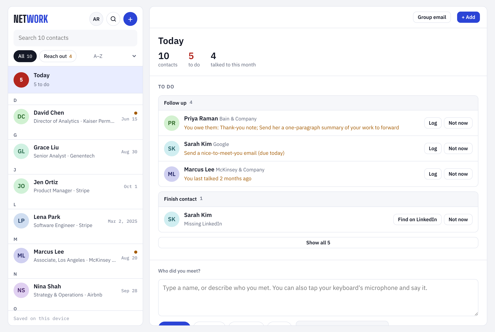
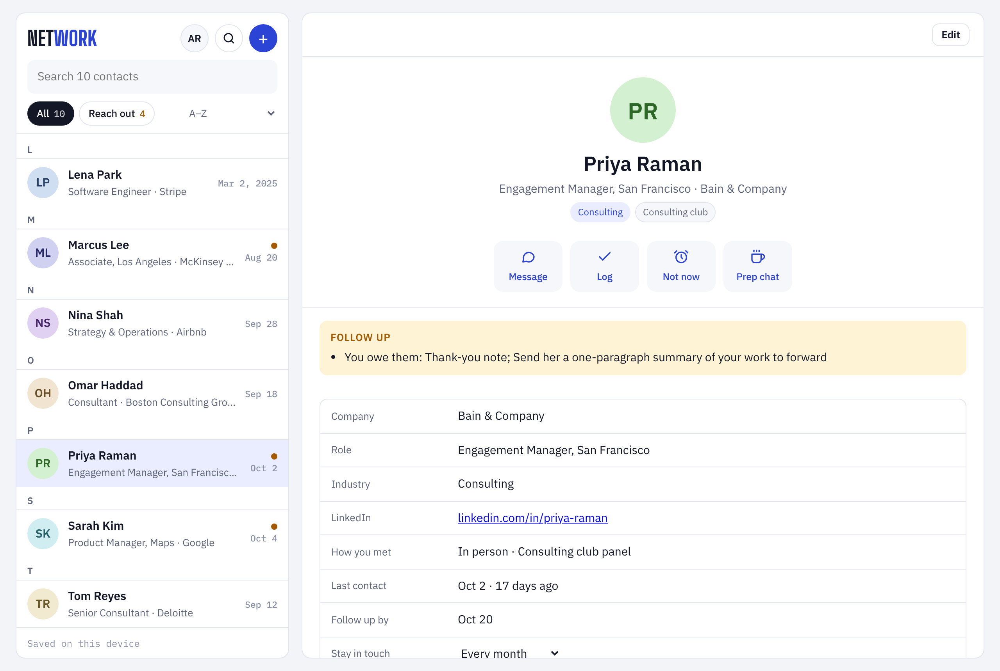
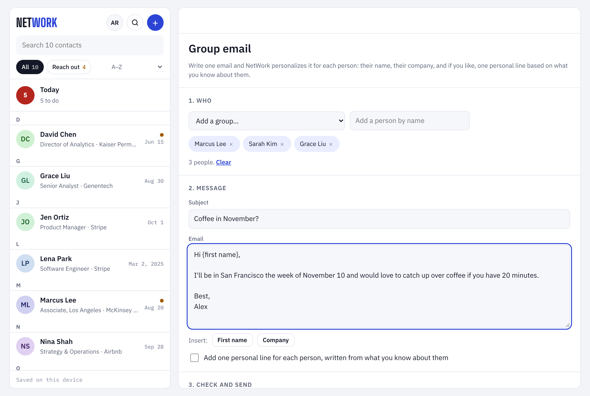
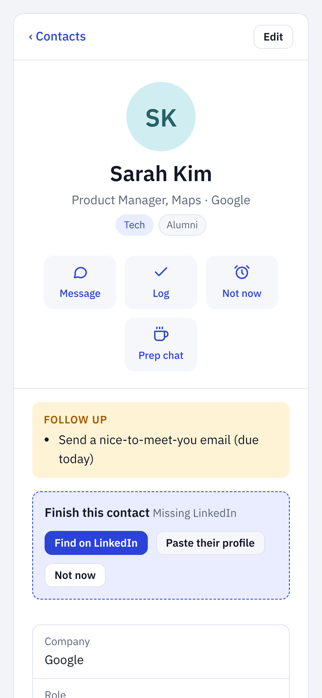
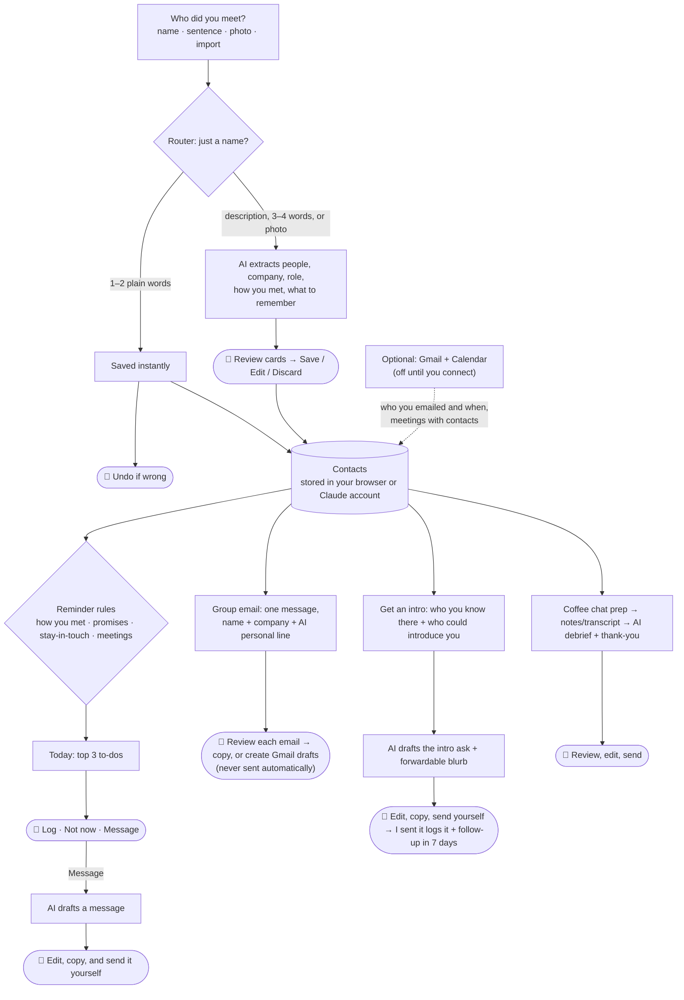
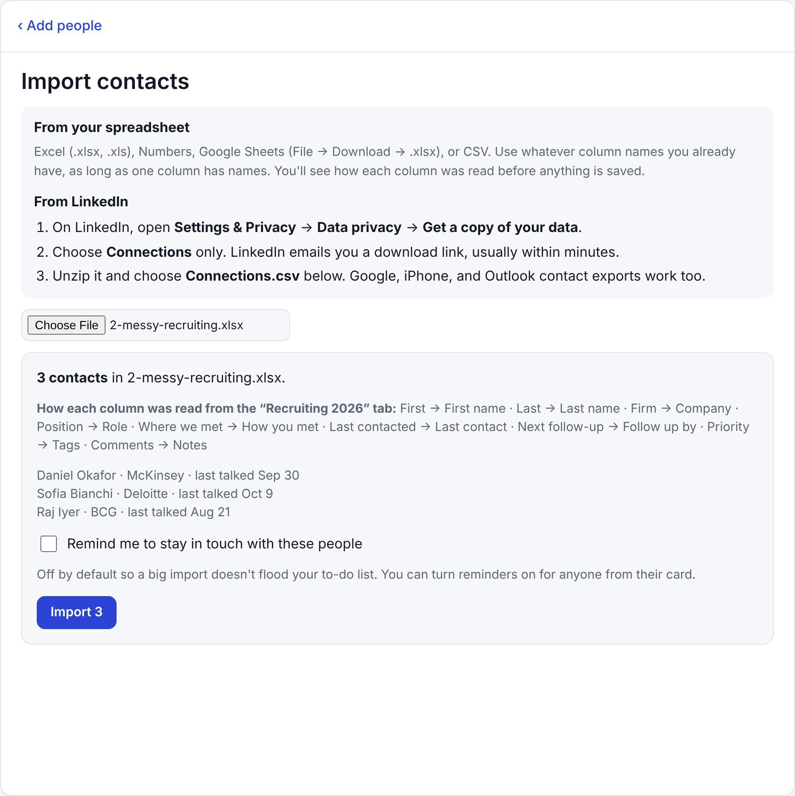
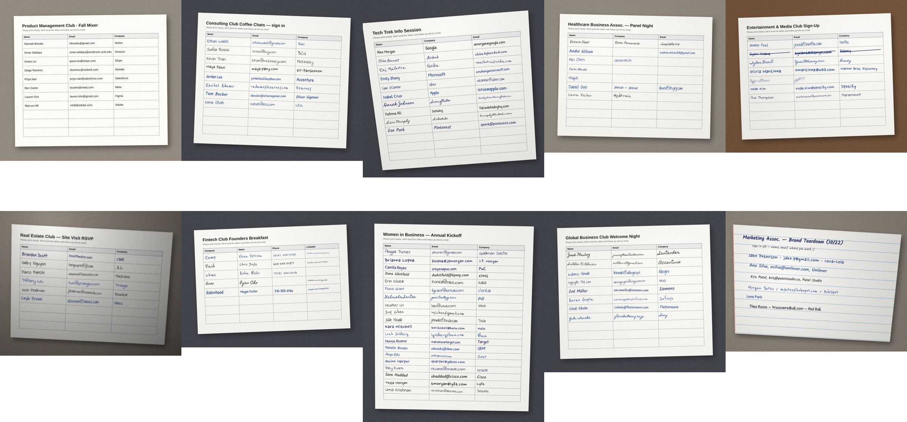
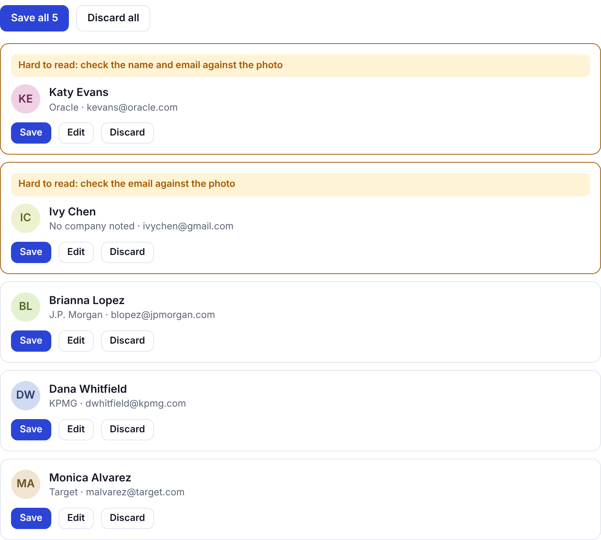

# NetWork

**A networking assistant for people who find reaching out and following up hard.**

**Try it:** https://net-work-ten.vercel.app (no sign-up; your contacts stay in your own browser)

Most people don't lose touch because they don't care. They lose touch because reaching out takes three things at once: remembering *when*, having a *reason*, and finding the *words*. NetWork handles all three. You tell it who you met, in your own words or by voice, and it keeps a lifelong map of your network, tells you who to reach out to (a few people at a time, never a flood), and drafts the message.

Built for an MBA course on designing useful AI solutions (final build). It's designed for anyone, not one person: each user sets up a short profile, and every AI feature works from it.



| A contact card | Group email | On a phone |
|---|---|---|
|  |  |  |

*Screenshots use made-up sample contacts.*

---

## The problem, through five questions

| Question | Answer |
|---|---|
| **What are we trying to improve?** | Staying in touch. For people who find networking draining, follow-ups slip, thank-you notes go unsent, and relationships quietly go cold. |
| **What does the system need to know?** | Who you met, where and how, what they said, what you promised them, when you last talked, and how often you want to stay in touch with them. |
| **What should it produce?** | Contact cards from a spoken or typed note; a short "Reach out" list with the reason for each person; a drafted message; and for coffee chats and interviews, prep questions, a debrief, a scorecard, and a thank-you note. |
| **How would we know it's good?** | Users reach out more often than before. Adding someone never creates a wrong contact (measured: 1 of 25 on a held-out set, down from 13; see [evaluation](docs/evaluation.md)). Drafted messages get sent with few edits. Nobody feels nagged. |
| **What feedback would improve it?** | Undo taps and corrections to parsed contacts (the router got it wrong), edits to drafts (how far the AI was from sendable), "Not now" taps (a nudge that came too early), and "Log" taps (a nudge that worked). |

## Current workflow vs. NetWork

| Step | Today | With NetWork |
|---|---|---|
| Meet someone | Maybe save a LinkedIn connection; details live in your head | Say "Met Sarah Kim, PM at Google, follow up next week" and a card is created |
| Remember to follow up | Rely on memory; usually forget | Shows up in "Reach out" when it's due, at most three at a time |
| Know what to say | Stare at a blank message, then put it off | Tap "Message" and get a short, specific note you can edit and send |
| Coffee chat or interview | Prep from scratch, take scattered notes, write the thank-you later (or never) | Prep questions from their background, a checklist during the call, a debrief and thank-you after |
| Find someone later | Scroll LinkedIn and try to remember | Group by company, industry, how you met, tag, or last contact, and search everything |

## What it does

**About you**
- A short profile (name, what you do, school, background, goals, and your 30-second story). Paste your LinkedIn profile or resume and it fills itself in. Prep, drafted messages, and search all use it, so the app works for any user, not a built-in persona.

**Email and calendar (optional, off until you connect them)**
- Connect Gmail and NetWork logs emails with your contacts automatically: "last contact" stays accurate, and follow-ups you owed are cleared once you've emailed someone. It looks only at who you emailed and when, never subjects or message content. It's off until you connect it, and you can turn it off anytime. It can also find email addresses for contacts who don't have one, for you to confirm. Available in the Claude version, which uses your own connected Gmail.
- Connect Google Calendar and NetWork spots meetings with your contacts (by their email, or their name in the event title). It reminds you to prep the day before, reminds you to debrief afterward, and logs the meeting in their history. It only reads the past week and the next week, skips big meetings and declined invites, and never changes your calendar.

**Network**
- **Follow-up rules based on how you met.** Meet someone in person and you get a reminder to send a nice-to-meet-you email the next day; after a video call, a thank-you note; after an intro, a reply to the intro. Online-only connections owe nothing. Logging an email or text clears the reminder. You can also add your own to-dos to anyone.
- **Get an intro.** Type who you want to meet ("someone at Stripe", "product managers in fintech") on Today. It instantly shows who you already know there and who could introduce you (same industry, worked there before, or your notes say they know people), then the AI refines it. Tap **Ask for an intro** and it drafts the request with a short blurb they can forward. Tap **I sent it** and it logs the ask and reminds you to follow up in a week. Works without the AI too (instant matches and a starter template).
- **One box to add people.** Type a name and it saves instantly. Type or dictate a sentence ("At the tech night I met Sarah... then Tom from Bain...") and the AI fills in each person for you to confirm. Mention someone already in your contacts ("had coffee with Jen, she's moving to NYC") and it logs the conversation instead.
- **Import your spreadsheet.** Most people already track contacts in Excel. Import a .xlsx, .xls, Numbers, or CSV file (or a LinkedIn, Google, iPhone, or Outlook export) with whatever column names you use: "Firm", "Employer", and "Org" all count as company, and "Where we met" counts as how you met. It skips title rows and instruction tabs, splits First/Last, and reads real Excel dates for last contact and follow-up, so reminders work right away. It shows how each column was read before anything is saved. If the headers are too unusual ("Who I talked to", "Where they're at now"), the AI maps them, with a check that the "name" column really holds names. Rows typed as one sentence ("Met Jake at Bain, jake@bain.com, follow up Friday") are split into fields by the AI and marked for you to check.
- **Add people from a photo.** Snap a sign-up sheet, attendee list, business card, or name tags and everyone on it is added. For groups larger than five, follow-up reminders stay off so your to-do list doesn't flood. Anything the AI isn't sure it read correctly is marked **Hard to read** so you check it against the photo before saving.
- **Group email.** Write one email to a group (everyone from an event, a company, or a tag). NetWork fills in each person's name and company, and can add one personal line per person from what you know about them. Copy each one, or, with Gmail connected, create a ready-to-send draft for each person. Nothing is ever sent automatically.
- **Import your existing network.** Upload LinkedIn's Connections.csv, or a Google, iPhone, or Outlook contacts export, or any spreadsheet with a Name column. Duplicates merge instead of doubling up, and imported contacts don't send reminders until you turn them on, so a 500-person import doesn't flood your to-do list.
- **Download everything.** One tap exports all contacts, notes, and history as a CSV, for backup or moving to another tool.
- **Organize any way.** Group by company, industry, how you met, your own tags, or how recently you talked. Search names, notes, and tags.
- **Reach out, without the pile-up.** Ranks who needs you (things you owe them, follow-up dates, people going quiet) and shows three at a time. Each person has their own stay-in-touch frequency, from monthly to never.
- **Two actions everywhere: Log and Not now.** Log records that you talked; Not now pushes a reminder back a week, a month, three months, or to a date you choose.
- **Drafted messages** that open with something specific to the person and never say "just checking in."

**Conversations (coffee chats and interviews)**
- **Prep:** paste their background and your goals. Get common ground, a tailored intro, ordered questions, what to avoid, and how to close. Interviews also get likely questions mapped to your own stories.
- **During:** a question checklist, timer, and notes with timestamps.
- **Debrief:** upload a Zoom transcript (.vtt) or paste one. Get takeaways, who promised what, personal details to remember, a five-part scorecard with evidence, and a thank-you note. All of it flows back into the person's card.

## How to use it

NetWork works like a contacts app: your contacts on the left, the selected person's card on the right (one screen at a time on a phone).

1. **Add people.** In "Who did you meet?" (on Today, or under **+**), type a name, describe people in a sentence, or tap **Photo** for a sign-up sheet or business card. Pick how you met (in person, video call, introduced, or online) and optionally where. "Fill in every field" and "Import contacts" are links underneath.
2. **Open Today** for your to-do list: **Follow up** (people to contact) and **Finish contact** (cards missing a company, role, or LinkedIn). **Find on LinkedIn** opens a pre-filled LinkedIn search; paste their profile link and text into the card and Claude fills in the details.
3. **Keep cards current.** Tap **Log** after any interaction (coffee, call, text, event) to build their history; last contact updates automatically. Add personal details under **Remember**; drafted messages use them.
4. **Follow up.** On a contact's card, tap **Message** for a drafted note, send it from your phone or email, then tap **Log**. Not ready? Tap **Not now**. To write to many people at once, use **Group email** on Today, or **Email group** next to a group in the contact list.
5. **Before a coffee chat or interview,** tap **Prep chat** on the person's card.
6. **After the call,** upload the transcript and run the debrief. Send the thank-you and tick **I sent it**.
7. **Find anyone** with search, the **Reach out** filter, or the group menu (A–Z, company, industry, how you met, tag, last contact).

## Run it

**Try it now:** the GitHub Pages link for this repo opens the app with no setup. Adding, logging, to-dos, import, and export all work there; the AI features (describe someone, drafts, prep, debrief, smart search) need either the Claude-hosted version or your own copy with an API key, below.

You need [Node.js](https://nodejs.org) 18 or newer and an [Anthropic API key](https://console.anthropic.com).

```bash
git clone https://github.com/<your-username>/network.git
cd network
cp .env.example .env        # then put your API key in .env
npm run dev                 # uses Node 20.6+; on older Node: ANTHROPIC_API_KEY=sk-ant-... npm start
```

Open http://localhost:3000.

## Deploy it (free, gives you a link to share)

1. Push this repo to GitHub.
2. Go to [vercel.com](https://vercel.com), sign in with GitHub, and import the repo. No build settings are needed.
3. In **Settings → Environment Variables**, add `ANTHROPIC_API_KEY`. Strongly recommended: also add `ACCESS_CODE` so only people you give the code to can use your API credits.
4. Deploy. Share the link and the access code with your class.

Also set a monthly spend limit on your API key in the Anthropic Console. Typical use costs a few cents per person per day.

## How it's built

- **`index.html`**: the whole app, plain HTML, CSS, and JavaScript with no framework or build step.
- **`api/claude.js`**: a small serverless function that forwards prompts to the Claude API. Your API key stays on the server and is never sent to the browser or committed to the repo.
- **`server.js`**: a dependency-free local server for development.

The same `index.html` also runs as a Claude artifact on claude.ai, where it uses Claude's built-in AI and storage instead of the API.

**What the AI knows, and what it doesn't.** The AI isn't browsing the web. It knows well-known companies and industries from its training, so it can tell Deloitte is a consulting firm, but it usually won't know a small local firm; in that case it leaves the field blank instead of guessing, and you fill it in or paste their LinkedIn profile. Everything else it knows about you and your contacts comes from what you enter. LinkedIn and Google links open in your own browser.

**Data and privacy.** In this version your contacts are stored only in your own browser (localStorage). Nothing is stored on a server. The text of a note, prep, or transcript is sent to the Claude API only when you press a button that needs AI. Clearing your browser data erases your network, and it does not sync between devices.

## Limitations

- Reminders appear when you open the app; there are no push notifications or emails yet.
- Voice input relies on your device's keyboard dictation; the app does not record audio itself.
- It can't look people up on LinkedIn by itself (LinkedIn doesn't allow it). It opens a pre-filled LinkedIn search, and you paste the profile back in.
- In the hosted version, contacts are stored in the browser, so they don't sync across devices. Use the CSV download to back up or move them.
- It doesn't listen to calls live; it works from the transcript afterward.

## Workflow, decisions, and human approval points

The AI suggests; the person decides. Nothing is saved from an AI guess, and nothing is ever sent, without a person approving it.



| Decision | Who makes it | Safeguard |
|---|---|---|
| Is this text a name or a description? | Rules ([evaluated](docs/evaluation.md)) | Ambiguous inputs go to the AI; **Undo** after instant saves |
| Who's in this sentence or photo, and what do we know? | AI | **Human reviews every card** before saving; unreadable photo rows are skipped, not guessed; uncertain fields are flagged **Hard to read** ([tested](docs/evaluation.md#evaluation-2-reading-sign-up-sheet-photos)) |
| Is this the same person as an existing contact? | AI + exact name match | Card says "Already in contacts"; person chooses Log it or Discard |
| Who should I follow up with, and when? | Rules (how you met, promises, cadence, meetings) | Max 3 at a time; **Not now** on everything; per-person "stay in touch" setting |
| What should the message say? | AI | **Person edits and sends**; the app never sends |
| Group email to 30 people | Person writes it, AI adds personal lines | Preview and edit each one; Gmail drafts only, behind a confirm step; no duplicates |
| Who could introduce me to someone at X? | Instant rules (company, notes, industry) + AI | Shown as suggestions with the reason; the person picks who to ask, edits the draft, and sends it |
| Read my email or calendar? | Person | Off by default; Claude permission prompt; reads only who and when, never message content |

## Evaluation

See [docs/evaluation.md](docs/evaluation.md) for full results, test data, and scripts. In short:

- **Typing a name vs. a description.** On held-out test inputs, the original rules created **13 wrong contacts out of 25 descriptions**. The shipped version creates **1** (95% routed correctly), and **Undo** covers the remaining case.
- **Importing spreadsheets.** 7 test files plus a real 120-person club tracker (1,080/1,080 fields right). The test files include sentence rows the AI splits. Earlier summary: 5 test files (a clean tracker, a messy personal sheet with title rows and an instructions tab, an old .xls, unusual headers, and a sheet with no people): 10 of 10 checks pass with and without AI. Unusual headers need the AI; a sheet with no names is refused instead of importing junk. Run `npm test`.
- **Reading sign-up sheet photos.** 10 synthetic sign-up sheet photos, 83 people, with answer keys, run through the live app. It found **all 83 people with every name exactly right** (accents included) and 97–99% of emails exact. It made up no fields and added no crossed-out rows. On deliberately terrible photos it mostly skips rather than guesses, but it made 6 confident misreads. After we added **"Hard to read" flags**, all of them (and both misses on the normal sheets) are highlighted on the review card before saving.

| Importing a messy Excel sheet | The 10 test photos | What you see when something is hard to read |
|---|---|---|
|  |  |  |

## What's next

- Weekly reminder outside the app (email or notification) with that week's three people and drafted messages
- Live web lookup in the hosted version, so the AI can fill in details about smaller companies
- Event prep: paste an attendee list to see who you already know and who to meet
- Give-back log: suggest intros between your own contacts
- Recruiting pipeline view per company
- Sync across devices for the hosted version
