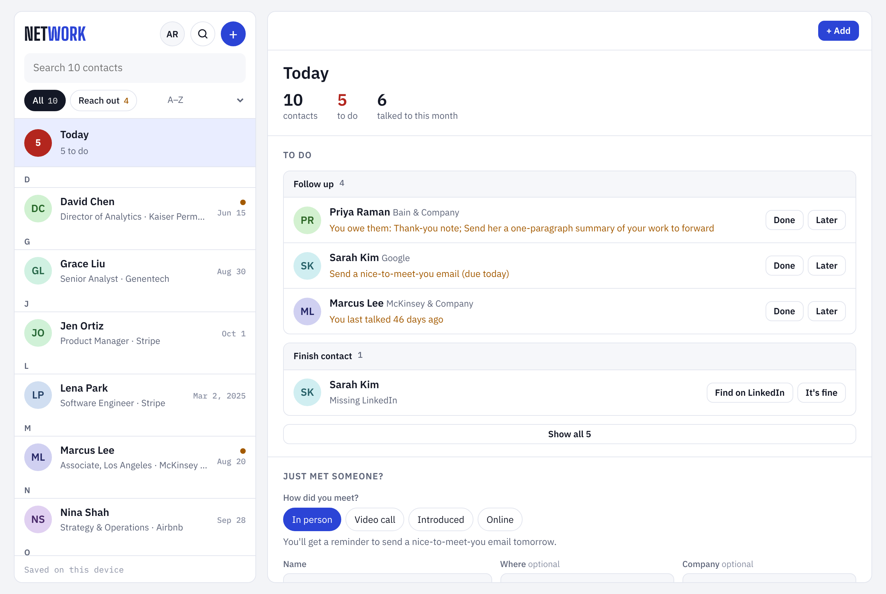
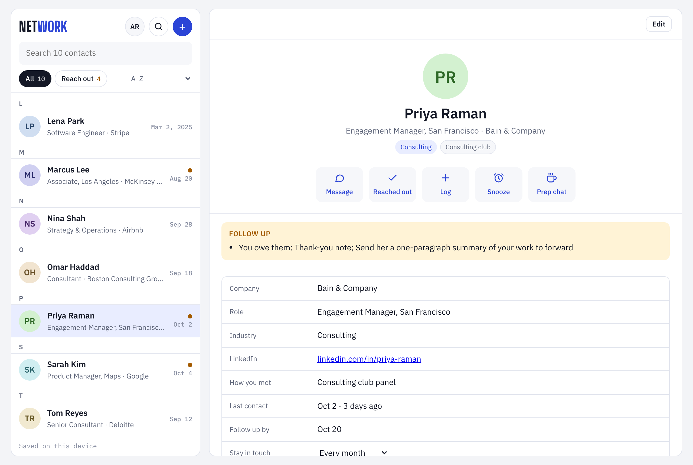
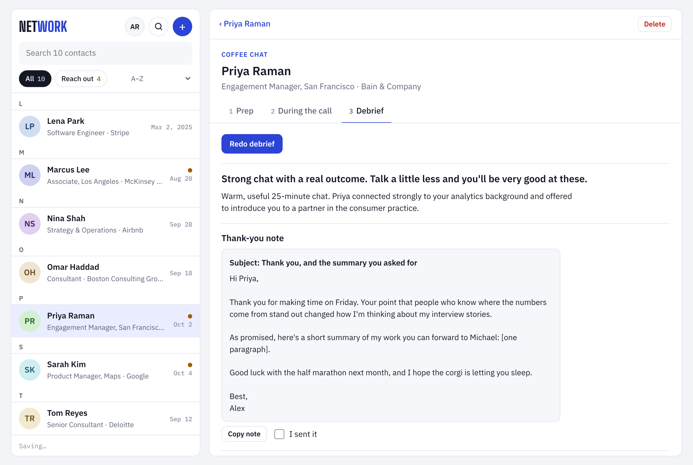
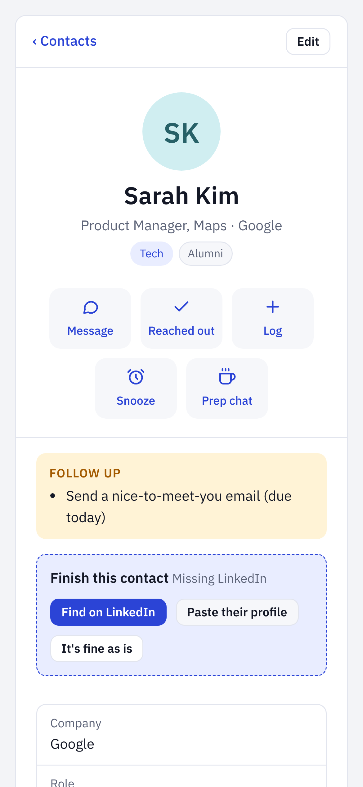

# NetWork

**A networking assistant for people who find reaching out and following up hard.**

Most people don't lose touch because they don't care. They lose touch because reaching out takes three things at once: remembering *when*, having a *reason*, and finding the *words*. NetWork handles all three. You tell it who you met, in your own words or by voice, and it keeps a lifelong map of your network, tells you who to reach out to (a few people at a time, never a flood), and drafts the message.

Built as Build #1 for an MBA course on designing useful AI solutions. It's designed for anyone, not one person: each user sets up a short profile, and every AI feature works from it.



| A contact card | Coffee chat debrief | On a phone |
|---|---|---|
|  |  |  |

*Screenshots use made-up sample contacts.*

---

## The problem, through five questions

| Question | Answer |
|---|---|
| **What are we trying to improve?** | Staying in touch. For people who find networking draining, follow-ups slip, thank-you notes go unsent, and relationships quietly go cold. |
| **What does the system need to know?** | Who you met, where and how, what they said, what you promised them, when you last talked, and how often you want to stay in touch with them. |
| **What should it produce?** | Contact cards from a spoken or typed note; a short "Reach out" list with the reason for each person; a drafted message; and for coffee chats and interviews, prep questions, a debrief, a scorecard, and a thank-you note. |
| **How would we know it's good?** | Users reach out more often than before. Parsed contacts are accurate. Drafted messages get sent with few edits. Nobody feels nagged. |
| **What feedback would improve it?** | Corrections to parsed contacts, edits to drafts, snoozes (a nudge that came too early), and "I reached out" taps (a nudge that worked). |

## Current workflow vs. NetWork

| Step | Today | With NetWork |
|---|---|---|
| Meet someone | Maybe save a LinkedIn connection; details live in your head | Say "Met Sarah Kim, PM at Google, follow up next week" and a card is created |
| Remember to follow up | Rely on memory; usually forget | Shows up in "Reach out" when it's due, at most three at a time |
| Know what to say | Stare at a blank message, then put it off | Tap "Draft a message" and get a short, specific note you can edit and send |
| Coffee chat or interview | Prep from scratch, take scattered notes, write the thank-you later (or never) | Prep questions from their background, a checklist during the call, a debrief and thank-you after |
| Find someone later | Scroll LinkedIn and try to remember | Group by company, industry, how you met, tag, or last contact, and search everything |

## What it does

**About you**
- A short profile (name, what you do, school, background, goals, and your 30-second story). Paste your LinkedIn profile or resume and it fills itself in. Prep, drafted messages, and search all use it, so the app works for any user, not a built-in persona.

**Network**
- **Follow-up rules based on how you met.** Meet someone in person and you get a reminder to send a nice-to-meet-you email the next day; after a video call, a thank-you note; after an intro, a reply to the intro. Online-only connections owe nothing. Logging an email or text clears the reminder. You can also add your own to-dos to anyone.
- **Find people.** Ask in plain English ("who do I know in fintech?", "alumni from my school at Bain SF"). It searches your contacts' companies, notes, history, and personal details, suggests who could introduce you, and writes LinkedIn and Google searches for finding new people.
- **Capture by voice or text.** Describe one person or a whole event's worth ("At the tech night I met Sarah... then Tom from Bain..."). Each person becomes a card you can check before saving. You can also add or edit anyone by hand.
- **Import your existing network.** Upload LinkedIn's Connections.csv, or a Google, iPhone, or Outlook contacts export, or any spreadsheet with a Name column. Duplicates merge instead of doubling up, and imported contacts don't send reminders until you turn them on, so a 500-person import doesn't flood your to-do list.
- **Download everything.** One tap exports all contacts, notes, and history as a CSV, for backup or moving to another tool.
- **Organize any way.** Group by company, industry, how you met, your own tags, or how recently you talked. Search names, notes, and tags.
- **Reach out, without the pile-up.** Ranks who needs you (things you owe them, follow-up dates, people going quiet) and shows three at a time. Each person has their own stay-in-touch frequency, from monthly to never.
- **Snooze** anyone for a week, a month, three months, or until a date you choose.
- **Drafted messages** that open with something specific to the person and never say "just checking in."

**Conversations (coffee chats and interviews)**
- **Prep:** paste their background and your goals. Get common ground, a tailored intro, ordered questions, what to avoid, and how to close. Interviews also get likely questions mapped to your own stories.
- **During:** a question checklist, timer, and notes with timestamps.
- **Debrief:** upload a Zoom transcript (.vtt) or paste one. Get takeaways, who promised what, personal details to remember, a five-part scorecard with evidence, and a thank-you note. All of it flows back into the person's card.

## How to use it

NetWork works like a contacts app: your contacts on the left, the selected person's card on the right (one screen at a time on a phone).

1. **Add people.** Tap **+** and pick how:
   - **Just met someone:** name and where you met, one tap to save. "Where" stays filled in, so you can add a whole event quickly.
   - **Describe them:** type or dictate a sentence about one or more people; AI fills in the details for you to confirm.
   - **Log a conversation:** pick someone already in your contacts and note what you talked about.
   - **Full details:** every field, with the less common ones under "More details".
   - **Import contacts:** upload LinkedIn's Connections.csv (Settings & Privacy → Data privacy → Get a copy of your data → Connections) or any contacts spreadsheet.
2. **Open Today** for your to-do list: **Follow up** (people to contact) and **Finish contact** (cards missing a company, role, or LinkedIn). **Find on LinkedIn** opens a pre-filled LinkedIn search; paste their profile link and text into the card and Claude fills in the details.
3. **Keep cards current.** Tap **Log** after any interaction (coffee, call, text, event) to build their history; last contact updates automatically. Add personal details under **Remember**; drafted messages use them.
4. **Follow up.** On a contact's card, tap **Message** for a drafted note, send it from your phone or email, then tap **Reached out**. Not now? **Snooze**.
5. **Before a coffee chat or interview,** tap **Prep chat** on the person's card.
6. **After the call,** upload the transcript and run the debrief. Send the thank-you and tick **I sent it**.
7. **Find anyone** with search, the **Reach out** filter, or the group menu (A–Z, company, industry, how you met, tag, last contact).

## Run it

You need [Node.js](https://nodejs.org) 18 or newer and an [Anthropic API key](https://console.anthropic.com).

```bash
git clone https://github.com/<your-username>/network.git
cd network
cp .env.example .env        # then put your API key in .env
npm run dev                 # uses Node 20.6+; on older Node: ANTHROPIC_API_KEY=sk-ant-... npm start
```

Open http://localhost:3000.

## Deploy it (free, gives you a link to share)

1. Push this repo to GitHub.
2. Go to [vercel.com](https://vercel.com), sign in with GitHub, and import the repo. No build settings are needed.
3. In **Settings → Environment Variables**, add `ANTHROPIC_API_KEY`. Strongly recommended: also add `ACCESS_CODE` so only people you give the code to can use your API credits.
4. Deploy. Share the link and the access code with your class.

Also set a monthly spend limit on your API key in the Anthropic Console. Typical use costs a few cents per person per day.

## How it's built

- **`index.html`**: the whole app, plain HTML, CSS, and JavaScript with no framework or build step.
- **`api/claude.js`**: a small serverless function that forwards prompts to the Claude API. Your API key stays on the server and is never sent to the browser or committed to the repo.
- **`server.js`**: a dependency-free local server for development.

The same `index.html` also runs as a Claude artifact on claude.ai, where it uses Claude's built-in AI and storage instead of the API.

**What the AI knows, and what it doesn't.** The AI isn't browsing the web. It knows well-known companies and industries from its training, so it can tell Deloitte is a consulting firm, but it usually won't know a small local firm; in that case it leaves the field blank instead of guessing, and you fill it in or paste their LinkedIn profile. Everything else it knows about you and your contacts comes from what you enter. LinkedIn and Google links open in your own browser.

**Data and privacy.** In this version your contacts are stored only in your own browser (localStorage). Nothing is stored on a server. The text of a note, prep, or transcript is sent to the Claude API only when you press a button that needs AI. Clearing your browser data erases your network, and it does not sync between devices.

## Limitations of v1

- Reminders appear when you open the app; there are no push notifications or emails yet.
- Voice input relies on your device's keyboard dictation; the app does not record audio itself.
- It can't look people up on LinkedIn by itself (LinkedIn doesn't allow it). It opens a pre-filled LinkedIn search, and you paste the profile back in.
- In the hosted version, contacts are stored in the browser, so they don't sync across devices. Use the CSV download to back up or move them.
- It doesn't listen to calls live; it works from the transcript afterward.

## How we'll evaluate it

1. **Capture accuracy.** Dictate 20 real "who I met" notes and count fields parsed correctly (name, company, role, follow-up date).
2. **Outreach rate.** Track messages sent to your network in a normal week, then in a week using NetWork.
3. **Draft quality.** Share of drafted messages sent with no edits or light edits.
4. **Nudge fatigue.** How often a nudge gets snoozed or ignored versus acted on. A high snooze rate means the reminders are too frequent.
5. **Debrief accuracy.** For three mock coffee chats, compare the extracted takeaways and promises to what was actually said.

## What's next

- Weekly reminder outside the app (email or notification) with that week's three people and drafted messages
- Live web lookup in the hosted version, so the AI can fill in details about smaller companies
- Event prep: paste an attendee list to see who you already know and who to meet
- Give-back log and suggested intros between your own contacts
- Recruiting pipeline view per company
- Sync across devices for the hosted version
